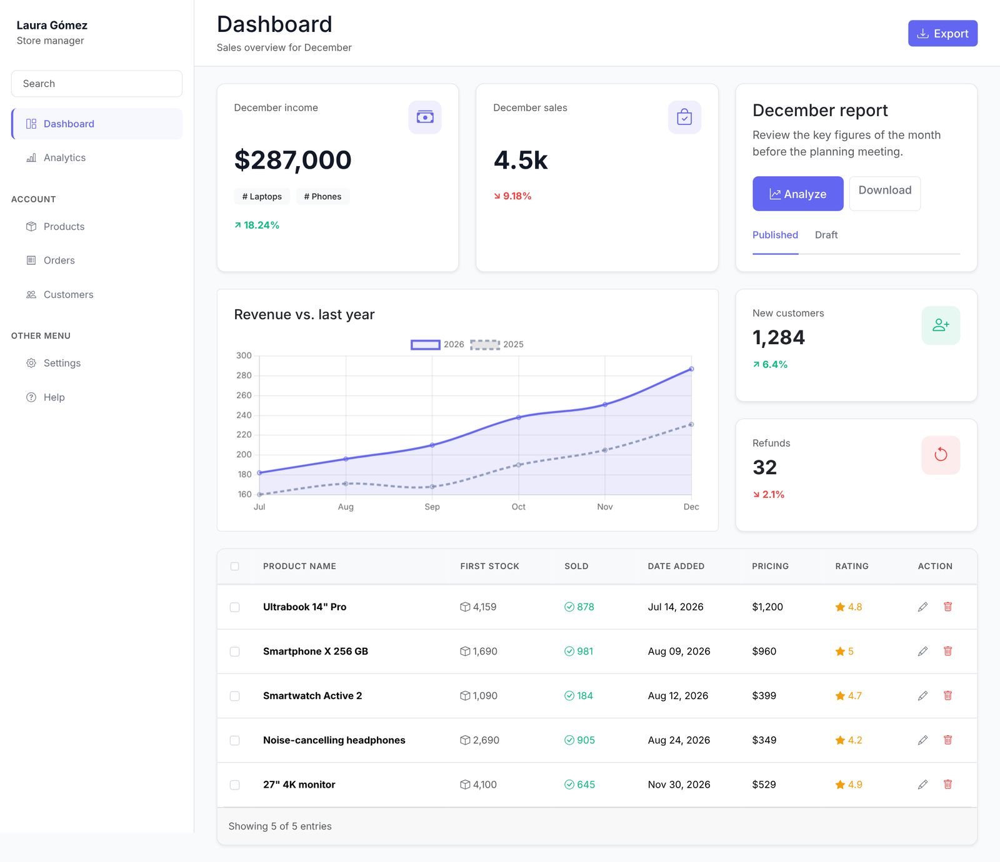
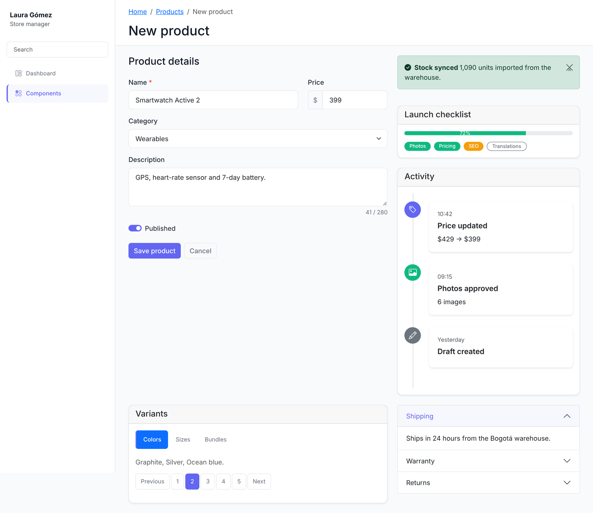

# Yii2 Dashboard UI

[](https://github.com/dannyrios81/yii2-ui/actions/workflows/tests.yml)
[](https://packagist.org/packages/iguazoft/yii2-ui)
[](https://packagist.org/packages/iguazoft/yii2-ui)
[](LICENSE)

**Arma un panel de administración moderno en Yii2 sin escribir HTML.** 39 widgets de Bootstrap 5 (layout, sidebar, tarjetas de métricas, gráficas con Chart.js, tablas, formularios, modales, timeline...) que se configuran con arrays de PHP, al estilo Yii.

[Read in English](README.md)



Esa página es [`examples/views/dashboard/index.php`](examples/views/dashboard/index.php): unas 150 líneas de PHP, sin CSS propio.

## Instalación

```bash
composer require iguazoft/yii2-ui
```

Registra los assets en tu layout o vista:

```php
\iguazoft\ui\DashboardAsset::register($this);
```

## Inicio rápido

```php
use iguazoft\ui\widgets\DashboardLayout;
use iguazoft\ui\widgets\MetricCard;
use iguazoft\ui\widgets\Sidebar;

<?php DashboardLayout::begin([
    'sidebar' => Sidebar::widget([
        'user' => ['name' => 'Laura Gómez', 'role' => 'Gerente de tienda'],
        'mainMenu' => [
            ['label' => 'Inicio', 'icon' => '<i class="bi bi-grid-1x2"></i>', 'url' => ['/dashboard'], 'active' => true],
            ['label' => 'Pedidos', 'icon' => '<i class="bi bi-receipt"></i>', 'url' => ['/orders']],
        ],
    ]),
    'header' => '<h2 class="mb-0">Inicio</h2>',
]); ?>

    <?= MetricCard::widget([
        'title' => 'Ingresos de diciembre',
        'value' => '287.000',
        'prefix' => '$',
        'trend' => 'up',
        'trendValue' => '18,24%',
        'icon' => '<i class="bi bi-cash-stack fs-4"></i>',
    ]) ?>

<?php DashboardLayout::end(); ?>
```

## Componentes



| Categoría | Widgets |
|---|---|
| **Dashboard** | `DashboardLayout`, `Sidebar`, `MetricCard`, `StatCard`, `ReportCard`, `ProductTable`, `Chart` |
| **Base** | `Card`, `Button`, `Badge`, `Alert` |
| **Formularios** | `Form`, `Input`, `Select`, `Checkbox`, `Radio`, `Textarea`, `FileUpload` |
| **Navegación** | `Navbar`, `Breadcrumb`, `Tabs`, `Pagination` |
| **Datos** | `DataTable`, `ListView`, `DetailView` |
| **Feedback** | `Modal`, `Toast`, `Progress`, `Spinner` |
| **Layout** | `Container`, `Row`, `Col`, `Grid`, `Divider` |
| **Avanzados** | `Dropdown`, `Accordion`, `Carousel`, `Timeline`, `Offcanvas` |

Detalles de cada widget, personalización y ejemplos de `Chart`, `ProductTable` y formularios en el [README en inglés](README.md).

## Seguridad

Los valores de `ProductTable`, `DataTable` y `DetailView` se escapan por defecto. Usa `'format' => 'raw'` solo con HTML de confianza.

## Licencia

MIT.
