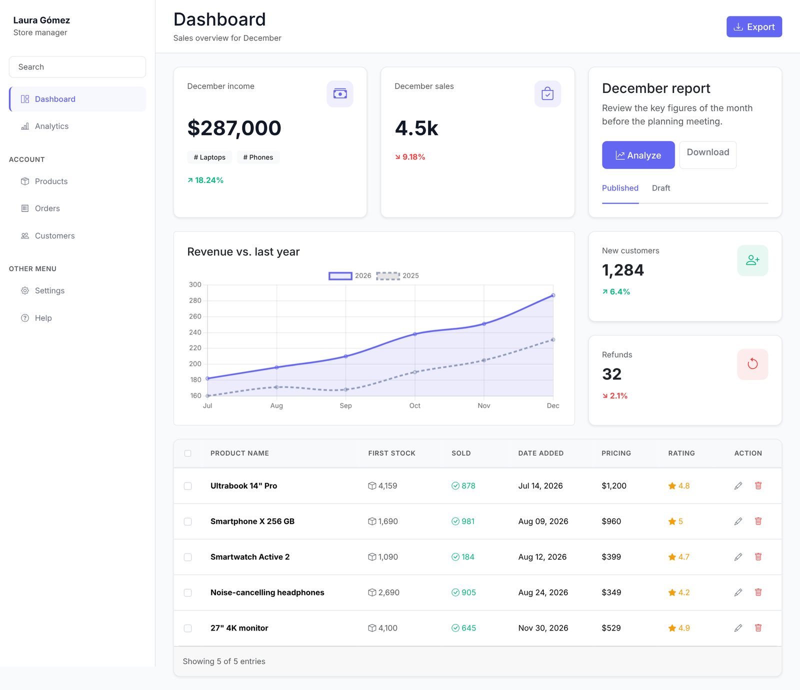
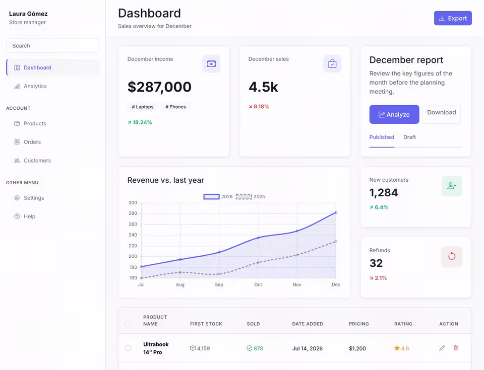
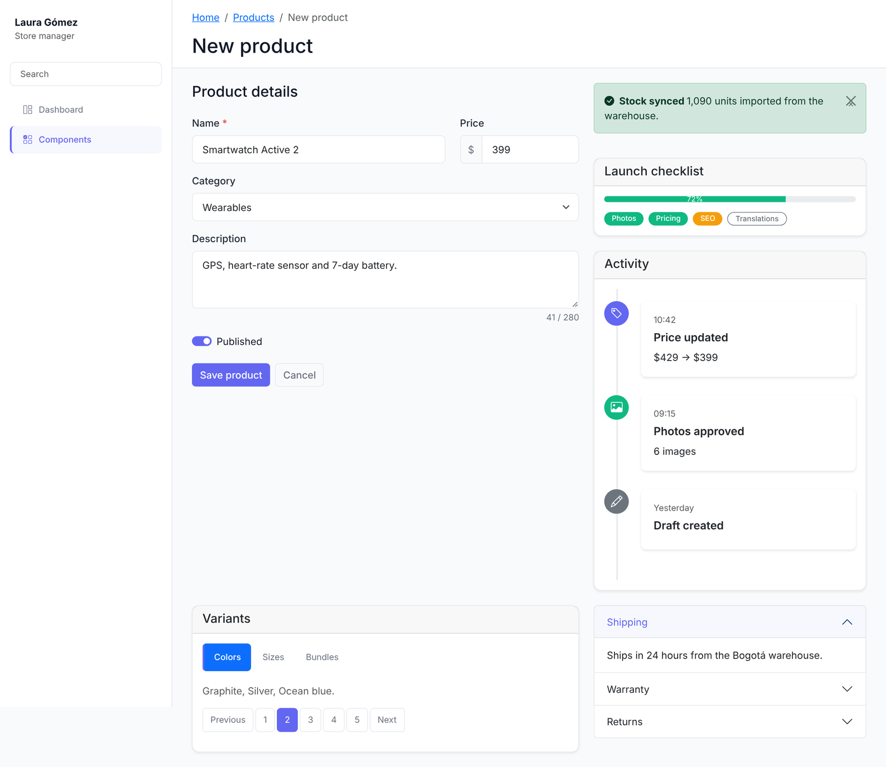
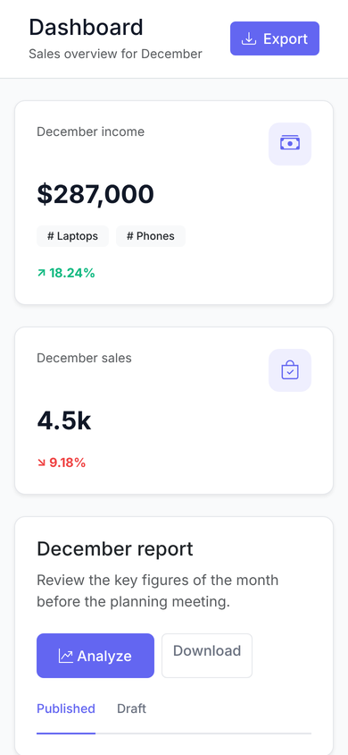

# Yii2 Dashboard UI

[](https://github.com/dannyrios81/yii2-ui/actions/workflows/tests.yml)
[](https://packagist.org/packages/iguazoft/yii2-ui)
[](https://packagist.org/packages/iguazoft/yii2-ui)
[](https://php.net/)
[](LICENSE)

**Build a modern admin dashboard in Yii2 without writing HTML.** 39 Bootstrap 5 widgets (layout, sidebar, metric cards, Chart.js charts, tables, forms, modals, timeline...) configured from PHP arrays, the Yii way.

[Leer en español](README.es.md)



The page above is [`examples/views/dashboard/index.php`](examples/views/dashboard/index.php): about 150 lines of PHP and no custom CSS.

## Why

- **Bootstrap 5, no jQuery plugins.** Uses `yiisoft/yii2-bootstrap5`, so it sits next to your existing widgets.
- **Pure PHP configuration.** Every widget is a normal `yii\base\Widget`: `MetricCard::widget([...])`, `DashboardLayout::begin()` / `end()`.
- **Secure by default.** Table and detail values are HTML-encoded unless you opt out with `'format' => 'raw'`.
- **Easy to theme.** Colors are CSS variables, every widget accepts `options`, and any widget can be extended.
- **Icons included.** Bootstrap Icons are registered for you; every `icon` option accepts HTML.

## Installation

```bash
composer require iguazoft/yii2-ui
```

Register the assets once, in your layout or view:

```php
use iguazoft\ui\DashboardAsset;

DashboardAsset::register($this);
```

## Quick start

```php
use iguazoft\ui\widgets\DashboardLayout;
use iguazoft\ui\widgets\MetricCard;
use iguazoft\ui\widgets\Sidebar;

<?php DashboardLayout::begin([
    'sidebar' => Sidebar::widget([
        'user' => ['name' => 'Laura Gómez', 'role' => 'Store manager'],
        'mainMenu' => [
            ['label' => 'Dashboard', 'icon' => '<i class="bi bi-grid-1x2"></i>', 'url' => ['/dashboard'], 'active' => true],
            ['label' => 'Orders', 'icon' => '<i class="bi bi-receipt"></i>', 'url' => ['/orders']],
        ],
    ]),
    'header' => '<h2 class="mb-0">Dashboard</h2>',
]); ?>

    <div class="row g-4">
        <div class="col-md-4">
            <?= MetricCard::widget([
                'title' => 'December income',
                'value' => '287,000',
                'prefix' => '$',
                'trend' => 'up',
                'trendValue' => '18.24%',
                'icon' => '<i class="bi bi-cash-stack fs-4"></i>',
            ]) ?>
        </div>
    </div>

<?php DashboardLayout::end(); ?>
```

Copy [`examples/`](examples/) into a Yii2 app for a complete dashboard and a forms page.



## Components



| Category | Widgets |
|---|---|
| **Dashboard** | `DashboardLayout`, `Sidebar`, `MetricCard`, `StatCard`, `ReportCard`, `ProductTable`, `Chart` |
| **Base** | `Card`, `Button`, `Badge`, `Alert` |
| **Forms** | `Form`, `Input`, `Select`, `Checkbox`, `Radio`, `Textarea`, `FileUpload` |
| **Navigation** | `Navbar`, `Breadcrumb`, `Tabs`, `Pagination` |
| **Data** | `DataTable`, `ListView`, `DetailView` |
| **Feedback** | `Modal`, `Toast`, `Progress`, `Spinner` |
| **Layout** | `Container`, `Row`, `Col`, `Grid`, `Divider` |
| **Advanced** | `Dropdown`, `Accordion`, `Carousel`, `Timeline`, `Offcanvas` |

Base and dashboard widgets live in `iguazoft\ui\widgets`; the rest in `iguazoft\ui\widgets\<category>` (for example `iguazoft\ui\widgets\forms\Input`).

## Examples

### Chart (Chart.js)

Chart.js is loaded automatically the first time a `Chart` is rendered.

```php
use iguazoft\ui\widgets\Chart;

<?= Chart::widget([
    'type' => 'line',
    'height' => '260px',
    'data' => [
        'labels' => ['Jul', 'Aug', 'Sep', 'Oct', 'Nov', 'Dec'],
        'datasets' => [[
            'label' => 'Revenue',
            'data' => [182, 196, 210, 238, 251, 287],
            'borderColor' => 'rgb(99, 102, 241)',
            'fill' => true,
        ]],
    ],
]) ?>
```

### ProductTable

```php
use iguazoft\ui\widgets\ProductTable;
use yii\helpers\Html;

<?= ProductTable::widget([
    'dataProvider' => $dataProvider,      // ActiveDataProvider, ArrayDataProvider or a plain array
    'columns' => [
        ['label' => 'Name', 'attribute' => 'name'],
        ['label' => 'Price', 'attribute' => 'price', 'format' => 'currency'],
        ['label' => 'Rating', 'attribute' => 'rating', 'format' => 'rating'],
        ['label' => 'Link', 'value' => fn($m) => Html::a('Open', ['view', 'id' => $m['id']]), 'format' => 'raw'],
    ],
]) ?>
```

Formats: `text` (default, HTML-encoded), `raw` / `html`, `currency`, `number`, `rating`, `badge`, `stock`, `sold`.

### Forms

```php
use iguazoft\ui\widgets\forms\Form;
use iguazoft\ui\widgets\forms\Input;
use iguazoft\ui\widgets\forms\Select;

<?php Form::begin(['action' => ['/products/create'], 'title' => 'Product details', 'submitLabel' => 'Save']); ?>
    <?= Input::widget(['name' => 'title', 'label' => 'Name', 'required' => true]) ?>
    <?= Input::widget(['name' => 'price', 'label' => 'Price', 'prepend' => '$', 'type' => 'number']) ?>
    <?= Select::widget(['name' => 'category', 'label' => 'Category', 'items' => $categories]) ?>
<?php Form::end(); ?>
```

## Customization

Override the CSS variables after `DashboardAsset`:

```css
:root {
    --dashboard-primary: #0d9488;
    --dashboard-primary-rgb: 13, 148, 136;
    --dashboard-sidebar-width: 260px;
}
```

Every widget accepts `options` (HTML attributes of the root element), and any widget can be extended:

```php
class MyCard extends \iguazoft\ui\widgets\Card
{
    public $shadow = false;
}
```

To serve Bootstrap Icons or Chart.js yourself instead of the jsDelivr CDN, override `iguazoft\ui\BootstrapIconsAsset` or `iguazoft\ui\ChartAsset` in `assetManager->bundles`.

## Mobile

The layout is responsive. Below 768px the sidebar slides out of view; any element with `data-sidebar-toggle` opens it:

```php
<button class="btn btn-light d-md-none" data-sidebar-toggle><i class="bi bi-list"></i></button>
```



## Testing

```bash
composer install
composer test
```

## Contributing

Issues and pull requests are welcome. See [CONTRIBUTING.md](CONTRIBUTING.md) and the [CHANGELOG](CHANGELOG.md).

## License

MIT. See [LICENSE](LICENSE).
